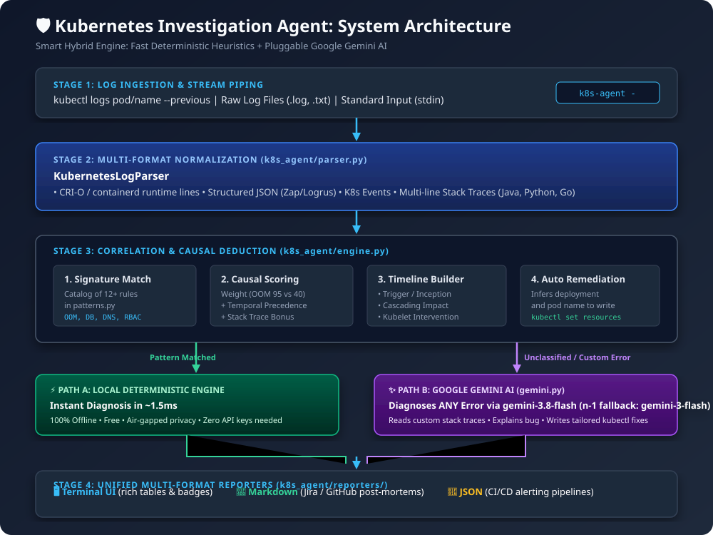
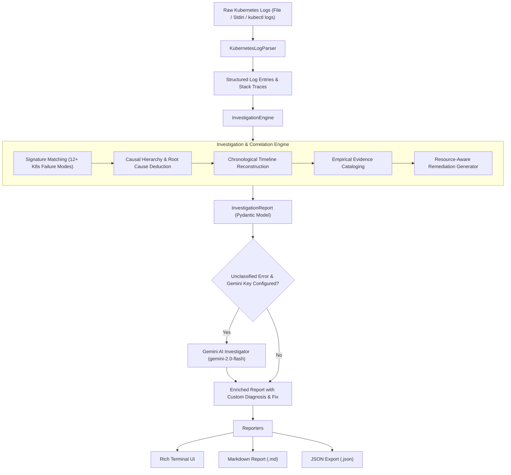

# 🛡️ Kubernetes Investigation Agent in Python

An autonomous Kubernetes investigation agent designed for DevOps, SREs, and Platform Engineers. The agent ingests Kubernetes pod logs, event streams, or cluster logs, performs deep causal failure analysis, and produces a structured investigation report backed by **empirical supporting evidence** (exact log lines, timestamps, and verbatim snippets).

---

## 🌟 Key Capabilities

- **Multi-Format Log Ingestion**:
  - Container runtime formats (**CRI-O**, **containerd**, **Docker** `stdout`/`stderr`).
  - Structured **JSON logs** (Zap, Logrus, Winston, Spring Boot).
  - Kubernetes Event logs (`kubectl get events`, `kubectl describe`).
  - Multi-line stack traces (**Python**, **Java**, **Go panics**, **Node.js**).
- **Causal Hierarchy & Root Cause Deduction**:
  - Differentiates the **underlying root cause** from **secondary cascading symptoms** (e.g., distinguishing an initial Out-of-Memory event or database failure from subsequent probe timeouts and `CrashLoopBackOff` restarts).
- **Empirical Supporting Evidence**:
  - Every finding links directly to exact line numbers, timestamps, and verbatim log excerpts with confidence ratings.
- **Chronological Failure Timeline**:
  - Maps the incident progression through distinct phases: *Trigger/Inception* → *Cascading Impact* → *Kubelet Intervention*.
- **Resource-Aware Remediation Plan**:
  - Auto-extracts pod and deployment names from logs to generate tailored, copy-pasteable `kubectl` commands for immediate mitigation and long-term prevention.
- **Multiple Output Formats**:
  - **Rich Interactive Terminal** with colored badges and structured tables.
  - **GitHub/GitLab Flavored Markdown** for incident tickets (Jira, GitHub Issues, Slack).
  - **Machine-readable JSON** for CI/CD pipelines, automated alerting, and webhook integration.
- **Smart Hybrid Engine (Deterministic + Google Gemini AI)**:
  - **Deterministic Core**: Instant local analysis (<5ms) for standard Kubernetes infrastructure failures (OOM, DB Outage, DNS, RBAC, Disk Full) with 100% privacy and zero API keys needed.
  - **Google Gemini AI Layer**: Automatically diagnoses **any** unclassified, custom, or obscure application stack trace that is not in the rulebook, providing custom code explanations and tailored `kubectl` fix commands.

---

## 🏗️ Architecture



> 📖 **Full Architectural Specifications & Sequence Diagrams**: For deep-dive diagrams, sequence interactions, and component specifications, see the **[docs/README.md](docs/README.md)**.



---

## 🚀 Quickstart

### 1. Installation

Clone or navigate to the repository and install the dependencies:

```bash
cd k8s-investigation-agent
pip install -e .
```

Or install dependencies directly:
```bash
pip install -r requirements.txt
```

---

## 💻 CLI Usage

The agent provides a command-line tool `k8s-agent` (or `python -m k8s_agent.cli`):

### 1. Analyze a Log File (Terminal View)

```bash
k8s-agent sample_logs/01_crashloop_oom.log
```

### 2. Pipe Logs Live from `kubectl`

```bash
kubectl logs deployment/checkoutservice --previous | k8s-agent -
```

### 3. Generate a Markdown Report for Incident Tickets

```bash
k8s-agent -f markdown -o incident_report.md sample_logs/02_db_connection_refused.log
```

### 4. Machine-Readable JSON Export

```bash
k8s-agent -f json -o report.json sample_logs/03_dns_and_config_missing.log
```

### 5. Diagnose ANY Unknown Error with Google Gemini AI

```bash
# Set your free Gemini API key
export GEMINI_API_KEY="AIzaSy..."

# The agent automatically invokes Gemini when it encounters an unclassified error
k8s-agent sample_logs/06_custom_payment_stripe_error.log

# Or pass it via CLI argument
k8s-agent --gemini-api-key "AIzaSy..." sample_logs/06_custom_payment_stripe_error.log
```

---

## 🐍 Python SDK Usage

You can embed the investigation agent directly into your Python microservices, bots, or CI/CD scripts:

```python
from k8s_agent import KubernetesInvestigationAgent

# Initialize the agent
agent = KubernetesInvestigationAgent()

# Investigate a log file or raw string
report = agent.investigate_file("sample_logs/01_crashloop_oom.log")

# Inspect structured diagnostic findings
print(f"Incident ID        : {report.incident_id}")
print(f"Primary Root Cause : {report.primary_root_cause}")
print(f"Severity           : {report.severity.value}")
print(f"Confidence Score   : {int(report.confidence_score * 100)}%")

# Access exact supporting evidence
for ev in report.key_evidence:
    print(f"Line {ev.line_numbers}: {ev.relevance_explanation}")
    print(f"Snippet: {ev.log_snippet}")

# Export formats
markdown_text = agent.to_markdown(report)
json_text = agent.to_json(report)
agent.print_terminal_report(report)
```

---

## 🧪 Included Sample Failure Scenarios

The repository includes realistic Kubernetes failure scenarios under `sample_logs/`:

| File | Scenario | Root Cause Isolated | Cascading Symptoms |
| :--- | :--- | :--- | :--- |
| `01_crashloop_oom.log` | Java Heap Exhaustion & OOMKiller | `OOM_KILL` (Exit 137) | Failed Liveness Probe, `CrashLoopBackOff` |
| `02_db_connection_refused.log` | PostgreSQL Connection Refused | `DATABASE_OUTAGE` | Failed Readiness Probe, Ingress 502 Bad Gateway |
| `03_dns_and_config_missing.log` | Missing ConfigMap & CoreDNS NXDOMAIN | `CONFIG_ERROR` | Container initialization block, upstream timeout |
| `04_rbac_permission_denied.log` | Kubernetes ServiceAccount RBAC Denied | `RBAC_PERMISSION` (403) | Operator controller crash |
| `05_tls_cert_expired.log` | Webhook Admission TLS Expired | `TLS_ERROR` | Pod admission blocked by webhook |
| `06_custom_payment_stripe_error.log` | Custom Python Stripe Authentication Crash | `PAYMENT_AUTH_ERROR` (Gemini) | Container crash, `CrashLoopBackOff` |

---

## 🔬 Running Unit Tests

Run the comprehensive test suite verifying the parser, heuristic engine, and end-to-end scenarios:

```bash
python -m unittest discover -s tests
```
