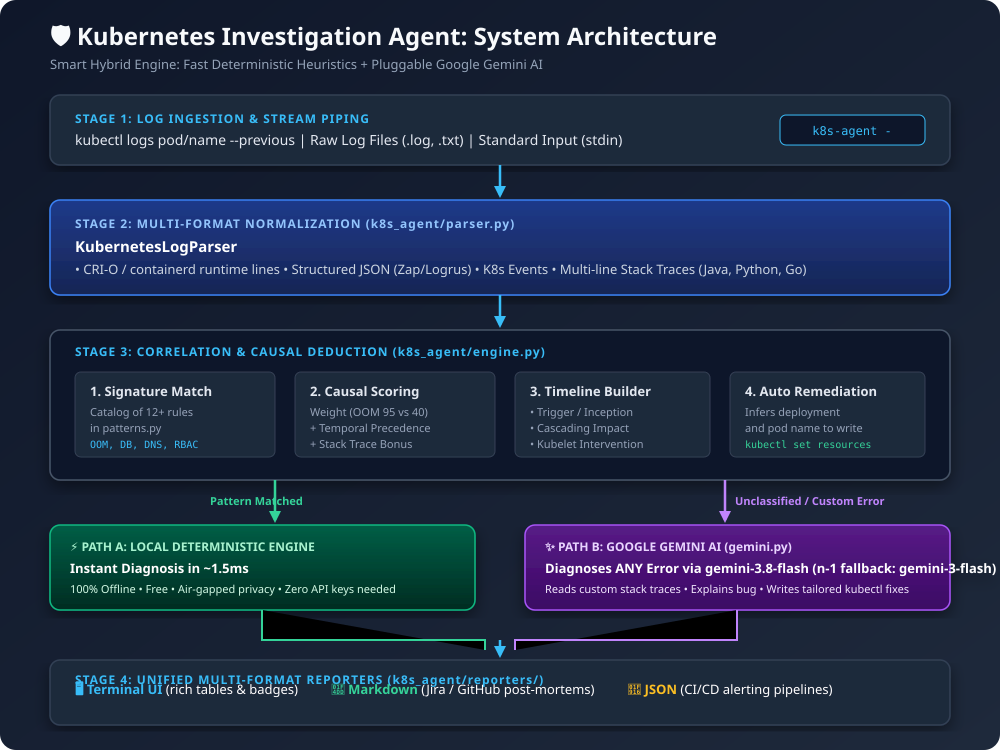
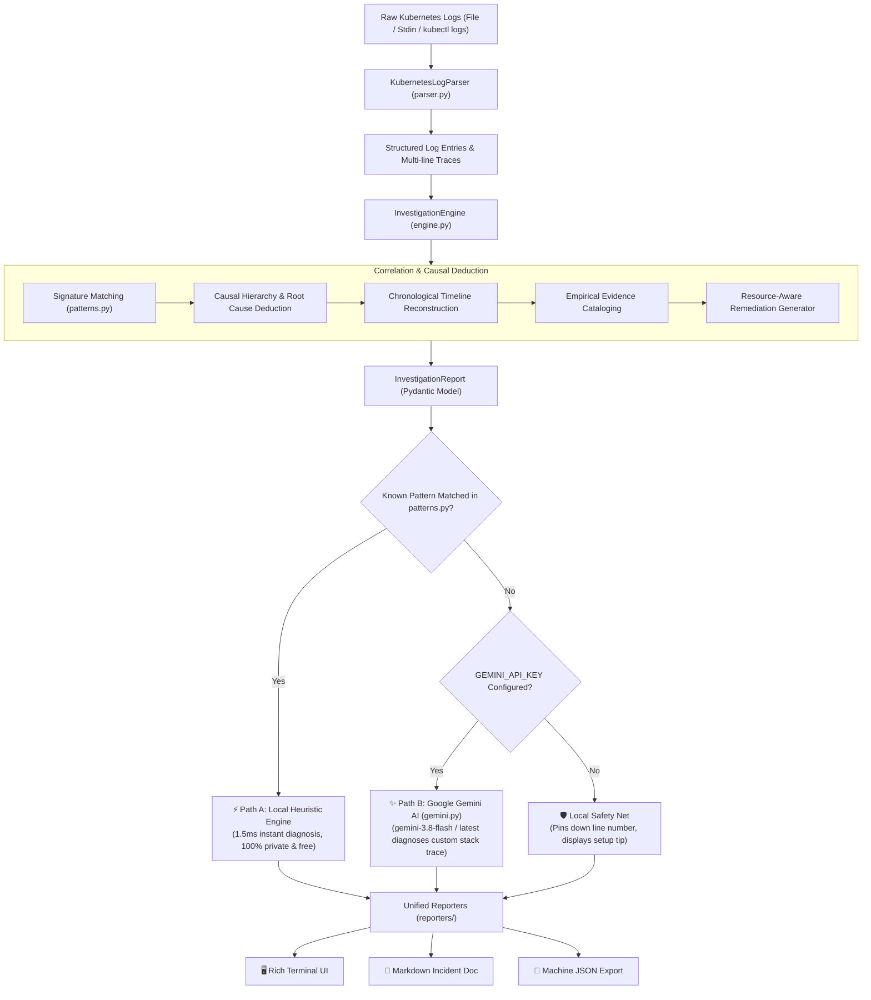
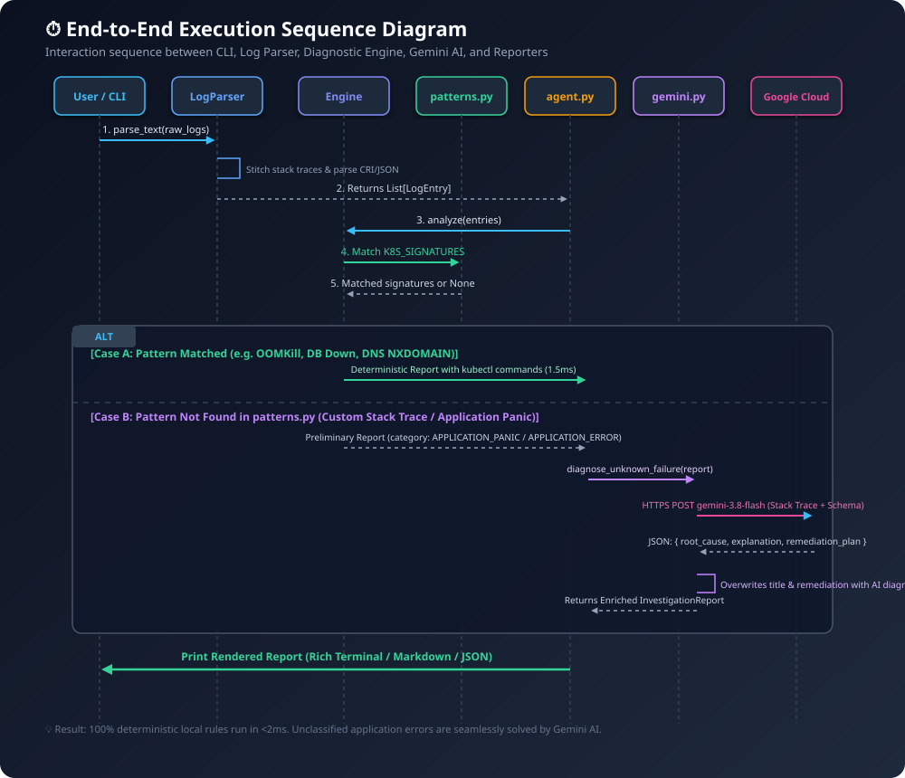
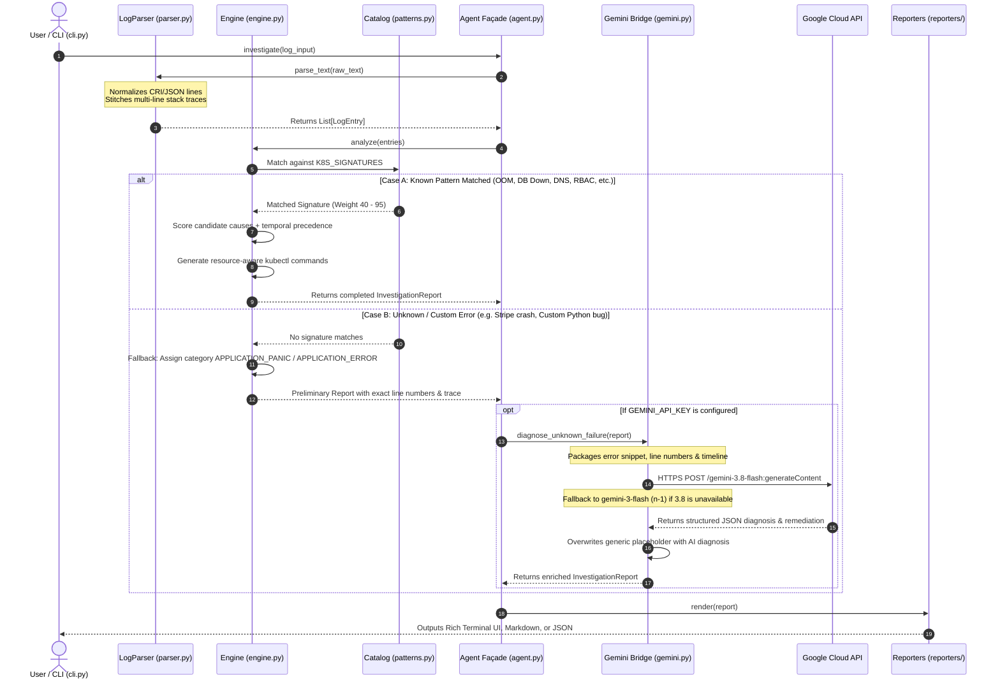

# 🛡️ Architecture & Technical Design Specifications

This directory contains the detailed architectural specifications, diagrams, and end-to-end execution flows for the **Kubernetes Investigation Agent**.

---

## 📑 Table of Contents
1. [System Architecture Diagram](#-1-system-architecture-diagram)
2. [End-to-End Execution Sequence](#-2-end-to-end-execution-sequence)
3. [The Smart Hybrid Decision Engine](#-3-the-smart-hybrid-decision-engine)
4. [Component & File Directory](#-4-component--file-directory)
5. [Real-World Failure Walkthroughs](#-5-real-world-failure-walkthroughs)

---

## 🏗️ 1. System Architecture Diagram

The agent uses a **Smart Hybrid Pipeline** combining an ultra-fast local deterministic engine with an optional Google Gemini AI layer for unknown errors.



### Mermaid Flowchart Definition:


---

## ⏱️ 2. End-to-End Execution Sequence

This sequence diagram illustrates how messages and data flow across components from initial CLI invocation to final report rendering:



### Mermaid Sequence Definition:


---

## 🧠 3. The Smart Hybrid Decision Engine

### Path A: Local Deterministic Engine (Default for Standard Errors)
- **When it runs**: Whenever logs match one of the 12+ pre-calibrated Kubernetes failure signatures in [`patterns.py`](../k8s_agent/patterns.py).
- **Execution Speed**: **~1.5 milliseconds**.
- **Privacy & Cost**: **100% Free, 100% Offline, Air-gapped**. No data leaves your machine.
- **Coverage**:
  - Out of Memory (`OOMKilled`, Exit code 137, Java heap space).
  - Missing ConfigMaps & Secrets (`CreateContainerConfigError`).
  - Container Image Pull Failures (`ImagePullBackOff`, `ErrImagePull`).
  - Database Connection Refused (Postgres, MySQL, Redis connection pool exhaustion).
  - CoreDNS / Cluster DNS Failures (`NXDOMAIN`, port 53 timeout).
  - RBAC Permission Denied (403 Forbidden).
  - Webhook TLS & Expired Certificates.
  - Storage Mount / PVC Volume locks.
  - Pod `CrashLoopBackOff` and failing Liveness/Readiness probes.

---

### Path B: Google Gemini AI Layer (For Custom / Unknown Errors)
- **When it runs**: Automatically invoked when an unclassified application error or runtime panic occurs (and a `GEMINI_API_KEY` is present).
- **Model**: `gemini-3.8-flash` (with n-1 fallback `gemini-3-flash`, and dynamic auto-discovery if set to `'latest'`).
- **Payload Optimization**: Does **not** send thousands of irrelevant log lines. Only the extracted, high-signal stack trace, line numbers, and timeline context are transmitted.
- **Output**: Returns a concrete Root Cause Title, technical explanation, and copy-pasteable remediation steps with deployment names automatically substituted.

---

## 📁 4. Component & File Directory

| File | Primary Class / Function | Purpose & Responsibility |
| :--- | :--- | :--- |
| [`k8s_agent/parser.py`](../k8s_agent/parser.py) | `KubernetesLogParser` | Ingests raw logs, normalizes timestamps, extracts severity levels, identifies pod names, and statefully stitches multi-line stack traces. |
| [`k8s_agent/patterns.py`](../k8s_agent/patterns.py) | `FailureSignature`, `K8S_SIGNATURES` | The domain rulebook: defines regex signatures, root cause weights (40 to 95), explanations, and default mitigation steps. |
| [`k8s_agent/engine.py`](../k8s_agent/engine.py) | `InvestigationEngine` | Core correlation engine: scores candidate causes using temporal precedence, builds chronological timelines, and infers Deployment names. |
| [`k8s_agent/gemini.py`](../k8s_agent/gemini.py) | `GeminiInvestigator` | Google Gemini AI integration: formats structured prompts, calls `gemini-3.8-flash` (or `gemini-3-flash`), and injects custom fixes for unknown errors. |
| [`k8s_agent/models.py`](../k8s_agent/models.py) | `InvestigationReport`, `LogEntry`, `Evidence` | Strongly typed Pydantic models defining reports, timeline events, evidence snippets, and remediation actions. |
| [`k8s_agent/agent.py`](../k8s_agent/agent.py) | `KubernetesInvestigationAgent` | Façade coordinating parser, engine, Gemini AI, and reporters into a clean, reusable API. |
| [`k8s_agent/cli.py`](../k8s_agent/cli.py) | `main()`, `build_parser()` | Command-line interface supporting file paths, stdin piping (`kubectl logs ... | k8s-agent -`), and format selection. |
| [`k8s_agent/reporters/`](../k8s_agent/reporters/) | `TerminalReporter`, `MarkdownReporter`, `JSONReporter` | Formats diagnostic reports for interactive terminals, incident tickets (Jira/Markdown), or CI/CD pipelines (JSON). |

---

## 🔬 5. Real-World Failure Walkthroughs

### Walkthrough 1: Java Heap Exhaustion & OOMKiller (`01_crashloop_oom.log`)
1. **The Log**:
   - Line 5: `java.lang.OutOfMemoryError: Java heap space`
   - Line 9: `Kernel cgroup out of memory: Killed process 42 exit code 137`
   - Line 11: `Liveness probe failed: connection refused`
   - Line 14: `Back-off restarting failed container (CrashLoopBackOff)`
2. **The Causal Problem**:
   - A naive tool reports `CrashLoopBackOff` (Line 14) because it is the most frequent message.
3. **The Agent's Deduction**:
   - Matches `SIG_OOM_KILL` on Line 5 (Weight: **95**).
   - Matches `SIG_CRASH_LOOP_BACKOFF` on Line 14 (Weight: **40**).
   - Calculates temporal precedence bonus for Line 5 (+15 points).
   - **Diagnosis**: Primary Root Cause isolated to **Line 5 (OOMKilled)**. Liveness probe and CrashLoop are classified as cascading symptoms.
   - **Remediation**: `kubectl set resources deployment/transaction-worker --limits=memory=2Gi`

---

### Walkthrough 2: Unclassified Stripe Payment Crash (`06_custom_payment_stripe_error.log`)
1. **The Log**:
   - Line 3: `Traceback (most recent call last):`
   - Line 5: `stripe.error.AuthenticationError: No API key provided. Set stripe.api_key.`
   - Line 6: `[FATAL] Worker terminated unhandled exception in thread Thread-3`
   - Line 7: `Back-off restarting failed container payment-svc`
2. **The Problem**:
   - This error is **not** in `patterns.py`. Standard Kubernetes rulebooks do not know what Stripe is.
3. **The Agent's Deduction (With Gemini)**:
   - The engine flags category as `APPLICATION_PANIC`.
   - The agent sends the 4-line stack trace to Gemini AI.
   - **Gemini's Diagnosis**:
     - **Root Cause**: `✨ Stripe API Key Authentication Failure`
     - **Executive Summary**: *"The checkout worker crashed because STRIPE_API_KEY was not configured in the pod environment."*
     - **Exact Fix Command**:
       ```bash
       kubectl set env deployment/payment-svc --from=secret/stripe-secret
       ```

